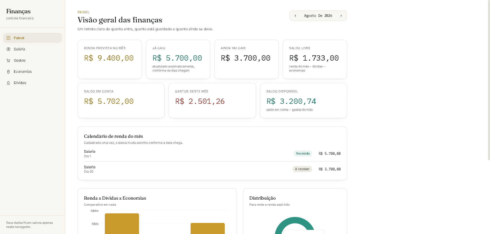
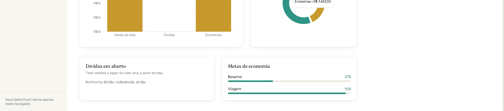

# Finanças — Controle de Finanças

Aplicação React para controle financeiro pessoal, com painel geral, salário/renda, economias e dívidas.

## Capturas de tela

<p align="center">
  
</p>

<p align="center">
  
</p>

## Estrutura de pastas

```
controle-financas/
├── index.html
├── package.json
├── tailwind.config.js
├── vite.config.js
└── src/
    ├── main.jsx                 # ponto de entrada
    ├── App.jsx                  # rotas da aplicação
    ├── index.css                # estilos globais + tokens
    ├── context/
    │   └── FinanceContext.jsx   # estado global (salário, economias, dívidas) + totais
    ├── hooks/
    │   └── useLocalStorage.js   # persistência no navegador
    ├── utils/
    │   └── format.js            # formatação de moeda e datas
    ├── components/
    │   ├── layout/               # Sidebar e Layout
    │   ├── common/                # Card, StatCard, Modal, EmptyState
    │   └── charts/                 # gráficos (Recharts)
    └── pages/
        ├── Dashboard/           # painel geral com métricas e gráficos
        ├── Salario/             # cadastro de rendas
        ├── Economias/           # metas de economia com progresso
        └── Dividas/             # dívidas com controle de pagamento
```

## Como rodar

```bash
npm install
npm run dev
```

Acesse http://localhost:5173

## Como funciona

- Os dados (salários, economias e dívidas) ficam salvos no `localStorage` do navegador — não há backend.
- **Renda recorrente automática**: ao cadastrar um salário, você informa o dia em que ele cai (ex: dia 5 e dia 20, como dois lançamentos separados). O sistema calcula sozinho, com base na data de hoje, o que já entrou e o que ainda vai entrar — sem precisar editar nada todo mês.
- O Painel tem um seletor de mês (‹ ›) que mostra a renda prevista, já recebida e a receber de qualquer mês — passado, atual ou futuro — sempre a partir da mesma renda cadastrada uma única vez.
- **Dívidas parceladas automáticas**: ao cadastrar uma dívida, você informa o valor da parcela, quantas parcelas ao todo, o dia de vencimento e em que mês começa a primeira parcela. O app calcula sozinho em qual parcela você está em cada mês, sem precisar marcar pagamento manualmente.
- Também calcula: total economizado, dívidas restantes (parcelas ainda não vencidas) e saldo livre (renda do mês − dívidas − economias).
- Cada página (Salário, Economias, Dívidas) tem seu próprio formulário de cadastro em modal.
- As metas de economia e as dívidas mostram barras de progresso.

## Tecnologias

- React 18 + Vite
- React Router
- Tailwind CSS (tokens de cor/tipografia personalizados)
- Recharts (gráficos)
